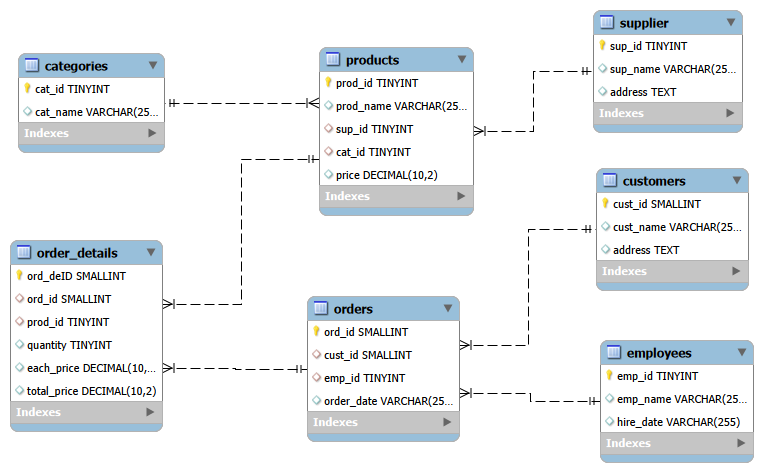

#  Grocery Store Management – SQL Data Analysis

## 📌 Project Overview

The Grocery Store Management project focuses on designing and analysing a relational database using MySQL.

The project simulates grocery store operations involving customers, products, suppliers, employees, orders and sales transactions.

The main objective is to analyse business data and extract meaningful insights related to customer purchasing behaviour, product performance, sales trends, supplier contributions and employee performance using SQL queries.

## 🎯 Project Objectives

- Design and implement a relational database for grocery store operations.
- Establish relationships between multiple tables using primary and foreign keys.
- Retrieve and manipulate data using SQL queries.
- Analyse customer purchasing patterns and product performance.
- Evaluate sales trends, supplier contributions and employee performance.
- Generate meaningful business insights through SQL-based analysis.

## 🛠️ Tools & Technologies

- MySQL
- MySQL Workbench
- SQL

## 🗂️ Database Description

The database consists of seven interrelated tables:

| Table Name | Description |
|---|---|
| `supplier` | Stores supplier details and addresses. |
| `categories` | Contains product category information. |
| `employees` | Stores employee details and hire dates. |
| `customers` | Contains customer information and addresses. |
| `products` | Stores product names, prices, suppliers and categories. |
| `orders` | Records customer orders, order dates and employees handling them. |
| `order_details` | Stores order items, quantities, unit prices and total prices. |

## 🧩 Entity Relationship Diagram

The ER diagram represents the relationships between the seven database tables, including their primary keys and foreign keys.

## 🔄 Project Workflow

### 1. Database Creation
- Created the `GROCERY_STORE` database.
- Designed seven relational tables.
- Defined primary keys and foreign key constraints.
- Established relationships between tables.

### 2. Data Importation
- Imported the provided datasets into MySQL.
- Verified table structures and imported records.
- Performed initial data inspections.

### 3. Data Preparation
- Inspected column data types.
- Identified date columns stored in `VARCHAR` format.
- Converted date columns into the appropriate `DATE` data type.
- Prepared data for further analysis.

### 4. Data Analysis
Performed SQL-based analysis across six major business areas.

## 📊 Business Analysis Areas

### 1. Customer Insights
- Number of unique customers who placed orders.
- Customers with the highest number of orders.
- Total and average purchase value per customer.
- Top 5 customers by total purchase amount.

### 2. Product Performance
- Number of products in each category.
- Average product price by category.
- Best-selling products by quantity.
- Total revenue generated by each product.
- Product sales by category and supplier.

### 3. Sales and Order Trends
- Total number of orders.
- Average order value.
- Dates with the highest order volume.
- Monthly order and revenue trends.
- Weekday vs weekend order patterns.

### 4. Supplier Contribution
- Total number of suppliers.
- Supplier providing the most products.
- Average product price by supplier.
- Supplier contribution to total sales revenue.

### 5. Employee Performance
- Number of employees who processed orders.
- Employees handling the highest number of orders.
- Total sales value processed by each employee.
- Average order value handled per employee.

### 6. Order Details Analysis
- Relationship between quantity ordered and total price.
- Average quantity ordered per product.
- Unit price variation across products and orders.

## 🚀 How to Run the Project

1. Install MySQL Server and MySQL Workbench.
2. Clone or download this repository.
3. Create the `GROCERY_STORE` database.
4. Create the seven tables using the SQL script.
5. Import the datasets into their respective tables.
6. Execute the analysis queries.
7. Review the query results.

## 👩‍💻 Author
**Sarika Kamala**

B.Tech – Computer Science and Engineering

**Interests:** Data Analysis | SQL | Python | Power BI

- GitHub: [Sarika-21](https://github.com/Sarika-21)
- LinkedIn: [LinkedIn Profile](https://www.linkedin.com/in/sarika-kamala/)
